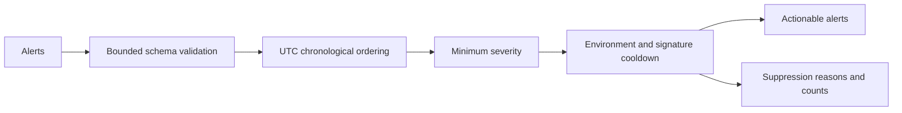

# Alert Noise Reduction

An explainable FastAPI service that turns a batch of observability alerts into
an actionable list with an audit trail of every suppression decision. The
algorithm is rule-based; it does not claim ML clustering or anomaly detection.

## Architecture



## Run locally

Use Python 3.14, then:

```sh
python -m venv .venv
# Windows PowerShell: .venv\Scripts\Activate.ps1
# macOS/Linux: source .venv/bin/activate
python -m pip install -r requirements-dev.lock
uvicorn app.main:app --reload --no-access-log
```

Open http://127.0.0.1:8000/docs.

```sh
curl -X POST http://127.0.0.1:8000/reduce-alert-noise -H "Content-Type: application/json" --data-binary @sample_alerts.json
```

In Windows PowerShell, use `curl.exe`. The four-event sample keeps two alerts and
suppresses two, producing **50% reduction on that sample only**.

## API contract

`GET /health` reports liveness. `POST /reduce-alert-noise` accepts:

- `alerts`: at most 1,000 alerts with unique `alert_id` values.
- `cooldown_minutes`: 0–1,440; defaults to 15.
- `minimum_severity`: `info`, `warning`, or `critical`; defaults to `warning`.

Each alert contains `alert_id`, `service`, `alert_name`, `severity`, and a
**timezone-aware** `timestamp`. Optional fields are `environment` (defaults to
`production`) and `message`. Unknown fields are rejected. HTTP bodies are capped
at 1 MiB. Set the environment explicitly when processing non-production events.

The signature is the normalized environment, service, alert name, and severity.
Volatile message text is excluded. Events are sorted by UTC timestamp and alert
ID; an event exactly at the cooldown boundary is retained. Suppressed duplicates
do not extend the cooldown. Different environments and severities remain separate.
Zero cooldown disables duplicate suppression while preserving severity filtering.
The structured signature is an array, avoiding delimiter collisions.

Responses contain `actionable_alerts`, `suppressed_alerts`, and `summary`, including
reason counts. Alert messages are returned to the caller; submit already-sanitized
logs when sensitive data is possible.

## Deployment

`API_KEY` protects the POST endpoint using `X-API-Key`. When
`ENVIRONMENT=production`, startup requires an API key of at least 32 characters.
Health and API schema endpoints remain public. Configure variables through your
shell or deployment secret manager; `.env.example` is not automatically loaded.

```sh
docker build -t alert-noise-reduction .
docker run --rm -p 127.0.0.1:8000:8000 alert-noise-reduction
```

The container runs without root. Put TLS, rate limiting, and timeouts at the
network ingress. Configure the standard `service.requests` Python logger at INFO
for JSON request metadata. Request IDs are returned in response headers. Bodies,
messages, and API keys are not logged by the application.

**Suppression is scoped to one batch.** Requests have no shared cooldown state;
replaying the same batch produces the same decisions, and duplicates spanning
requests are not suppressed. This stateless contract supports multiple workers.
If a caller needs continuous suppression, it must supply the entire cooldown
window or implement durable state in a future version. No external database has
been introduced.

## Verification

```sh
python -m unittest discover -s tests -v
```

Tests cover exact cooldown boundaries, timezone equivalence, environment
isolation, normalization, severity filtering, empty batches, authentication,
payload limits, and sanitized validation errors. CI adds dependency auditing and
a container build. No production alert-volume or MTTR claims are made.
